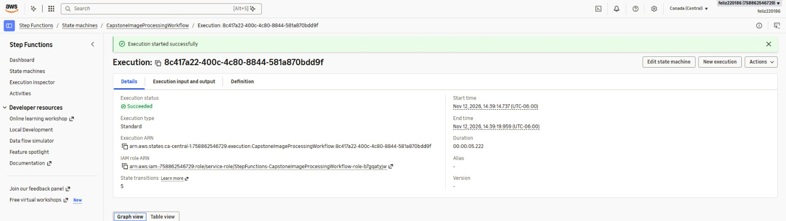
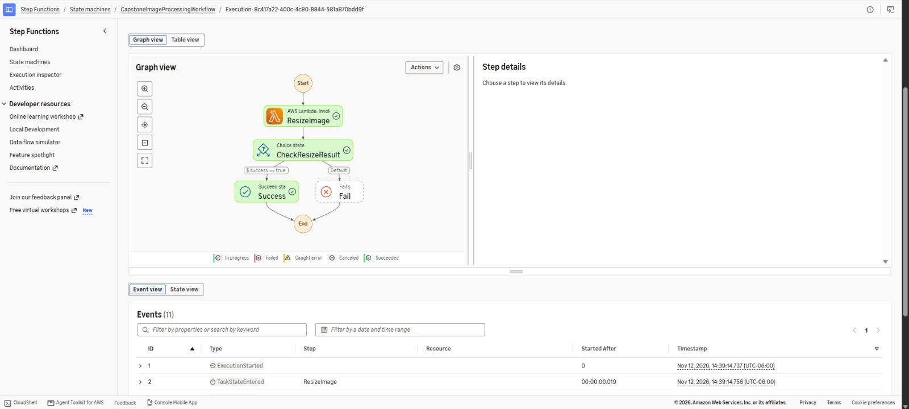
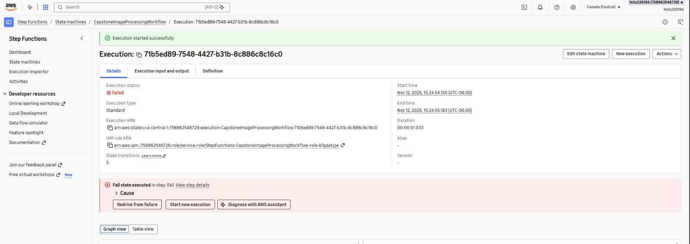
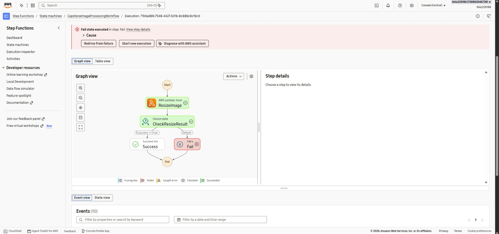
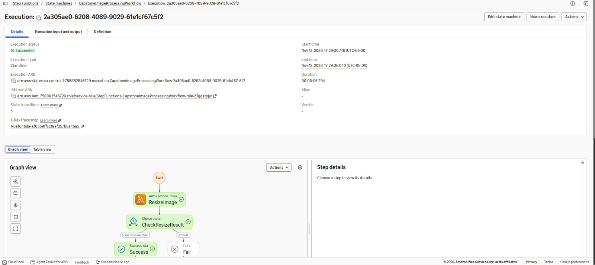
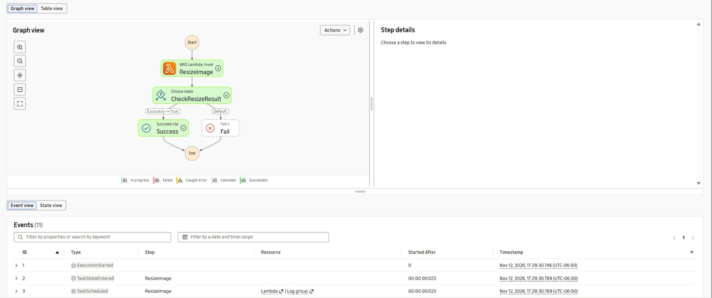
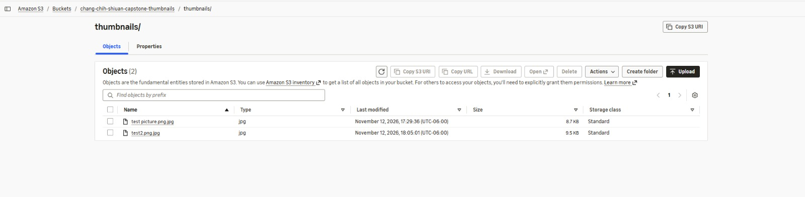

# Serverless Image Processing Pipeline

## 1. Project Overview

This capstone project uses AWS serverless services to automatically resize uploaded images into thumbnails.

Amazon S3 stores original images and generated thumbnails in separate buckets. AWS Lambda processes images using Python and Pillow. AWS Step Functions manages the image processing workflow, while Amazon API Gateway provides an endpoint to start the workflow.

The system supports two image processing methods:

- Automatic processing when an image is uploaded to the original S3 bucket.
- API-based processing through API Gateway and Step Functions.

Both methods have been successfully tested.

## 2. System Architecture

The system uses the following AWS services:

- **Amazon S3:** Stores original images and generated thumbnails in separate buckets.
- **AWS Lambda:** Resizes images using Python and Pillow while preserving aspect ratio.
- **AWS Step Functions:** Manages image processing using Task, Choice, Succeed, and Fail states.
- **Amazon API Gateway:** Provides a REST API endpoint to start the Step Functions workflow.
- **AWS IAM:** Controls permissions between AWS services and protects the deployed API.
- **Amazon CloudWatch:** Records Lambda execution logs.

### Automatic S3 Processing

1. A user uploads an image to the original S3 bucket.
2. The S3 object creation event automatically triggers AWS Lambda.
3. Lambda downloads and resizes the image.
4. The generated thumbnail is uploaded to the destination S3 bucket.

### API Gateway and Step Functions Workflow

1. A client sends a POST request to API Gateway.
2. API Gateway starts the Step Functions state machine.
3. The `ResizeImage` state invokes AWS Lambda.
4. Lambda processes the image and uploads the thumbnail to S3.
5. The `CheckResizeResult` state examines the Lambda response.
6. The workflow enters the `Success` or `Fail` state.

## 3. AWS Resources and Prerequisites

An AWS account with access to S3, Lambda, Step Functions, API Gateway, IAM, and CloudWatch is required.

| Resource | Configuration |
|---|---|
| AWS Region | Canada (Central) - `ca-central-1` |
| Original S3 Bucket | `chang-chih-shiuan-capstone-originals` |
| Thumbnail S3 Bucket | `chang-chih-shiuan-capstone-thumbnails` |
| Lambda Function | `CapstoneResizeImage` |
| Runtime | Python 3.14 |
| Architecture | x86_64 |
| Image Processing Library | Pillow |
| Lambda Layer | `CapstonePillow` Version 2 |
| Lambda Memory | 512 MB |
| Lambda Timeout | 30 seconds |
| Step Functions | `CapstoneImageProcessingWorkflow` |
| State Machine Type | Standard |
| API Gateway | `CapstoneImageProcessingAPI` |
| API Method | POST |
| API Resource | `/process-image` |
| Deployment Stage | `dev` |
| API Authorization | AWS IAM |

### Step Functions ARN

`arn:aws:states:ca-central-1:758862546729:stateMachine:CapstoneImageProcessingWorkflow`

### API Gateway Endpoint

`https://36daym1xy1.execute-api.ca-central-1.amazonaws.com/dev/process-image`

The deployed API uses AWS IAM authorization. External requests must be signed with valid AWS credentials that have permission to invoke the API.

## 4. Deployment Instructions

### Step 1: Create S3 Buckets

Create two S3 buckets in the Canada (Central) region:

- `chang-chih-shiuan-capstone-originals`
- `chang-chih-shiuan-capstone-thumbnails`

Keep public access blocked for both buckets.

When deploying to another AWS account, choose globally unique bucket names.

### Step 2: Create the Lambda Function

1. Create a Lambda function named `CapstoneResizeImage`.
2. Select Python 3.14 and x86_64 architecture.
3. Add the source code from `lambda_function.py`.
4. Create and attach a compatible Pillow Lambda Layer.
5. Configure memory to 512 MB and timeout to 30 seconds.

Configure the following environment variables:

- `ORIGINAL_BUCKET=chang-chih-shiuan-capstone-originals`
- `THUMBNAIL_BUCKET=chang-chih-shiuan-capstone-thumbnails`

Configure IAM permissions to allow:

- `s3:GetObject` on the original S3 bucket.
- `s3:PutObject` on the thumbnail S3 bucket.
- CloudWatch logging.

The Lambda function creates JPEG thumbnails with a maximum size of 256 × 256 pixels while preserving the original aspect ratio.

### Step 3: Create Step Functions

Create a Standard state machine named `CapstoneImageProcessingWorkflow`.

Use the definition provided in `state_machine.json`.

The workflow includes four states:

1. **ResizeImage:** Invokes the Lambda function.
2. **CheckResizeResult:** Checks whether `$.success` equals `true`.
3. **Success:** Ends the workflow successfully.
4. **Fail:** Ends the workflow when image processing fails.

Configure the Step Functions execution role with permission to invoke `CapstoneResizeImage`.

### Step 4: Configure API Gateway

1. Create a REST API named `CapstoneImageProcessingAPI`.
2. Select a Regional endpoint in `ca-central-1`.
3. Create a resource named `/process-image`.
4. Add a POST method.
5. Select AWS service integration with Step Functions.
6. Configure the `StartExecution` action.
7. Create an IAM role with permission to perform `states:StartExecution` on the state machine.
8. Configure an `application/json` mapping template to pass the request body as the Step Functions execution input and specify the state machine ARN.
9. Set method authorization to AWS IAM.
10. Deploy the API to the `dev` stage.

### Step 5: Configure the Automatic S3 Trigger

1. Open the `CapstoneResizeImage` Lambda function.
2. Select **Add trigger**.
3. Choose Amazon S3.
4. Select `chang-chih-shiuan-capstone-originals`.
5. Select **All object create events**.
6. Leave Prefix and Suffix empty.
7. Add the trigger.

The original and thumbnail buckets are separate to prevent recursive S3 invocation.

## 5. How to Run and Test

### Test 1: Manual Step Functions Execution

1. Upload `test picture.png` to the original S3 bucket.
2. Open `CapstoneImageProcessingWorkflow` in AWS Step Functions.
3. Click **Start execution**.
4. Enter the following JSON input:

```json
{
  "bucket": "chang-chih-shiuan-capstone-originals",
  "key": "test picture.png"
}
```

5. Start the execution.
6. Verify that the workflow reaches the `Success` state.
7. Open the thumbnail S3 bucket.
8. Verify that `thumbnails/test picture.png.jpg` was created.

### Test 2: Step Functions Failure Handling

1. Start another Step Functions execution.
2. Enter the following JSON input:

```json
{
  "bucket": "chang-chih-shiuan-capstone-originals",
  "key": "nonexistent-test-image.jpg"
}
```

3. Start the execution.
4. Verify that Lambda reports an unsuccessful image processing result.
5. Confirm that `CheckResizeResult` directs the workflow to the `Fail` state.

### Test 3: API Gateway Integration

1. Open `CapstoneImageProcessingAPI` in API Gateway.
2. Select the `/process-image` POST method.
3. Open the **Test** tab.
4. Set the request header to `Content-Type:application/json`.
5. Enter the following request body:

```json
{
  "bucket": "chang-chih-shiuan-capstone-originals",
  "key": "test picture.png"
}
```

6. Execute the API Gateway method test.
7. Confirm that the response returns HTTP status `200` and an `executionArn`.
8. Open Step Functions and verify that the new execution reaches `Success`.

The API Gateway console test invokes the integration directly. The deployed API endpoint requires AWS IAM authorization.

### Test 4: Automatic S3 Trigger

1. Open the original S3 bucket.
2. Upload a new image named `test2.png`.
3. Confirm that the upload succeeds.
4. Open `chang-chih-shiuan-capstone-thumbnails`.
5. Navigate to the `thumbnails/` folder.
6. Verify that `test2.png.jpg` was automatically created.

This test confirms that the S3 event triggers Lambda without a manual Lambda or Step Functions execution.

## 6. Testing Results

All planned functional tests were completed successfully.

| Test | Expected Result | Actual Result |
|---|---|---|
| Manual Step Functions execution | Workflow reaches Success | Succeeded |
| Step Functions failure handling | Workflow reaches Fail for an invalid image key | Failed as expected |
| API Gateway integration | API starts Step Functions | HTTP 200 |
| API-triggered Step Functions execution | Workflow reaches Success | Succeeded |
| Automatic S3 trigger | Upload automatically generates a thumbnail | Succeeded |

### 6.1 Manual Step Functions Success Test

The Step Functions workflow was tested successfully on November 12, 2026.

- **Execution status:** Succeeded
- **Execution duration:** 5.222 seconds
- **Execution path:** ResizeImage → CheckResizeResult → Success
- **Thumbnail created:** `thumbnails/test picture.png.jpg`
- **Thumbnail size:** 8.7 KB





### 6.2 Step Functions Failure Test

The workflow was tested using a nonexistent S3 object key.

- **Execution status:** Failed (expected)
- **Execution duration:** 1.033 seconds
- **Execution path:** ResizeImage → CheckResizeResult → Fail

The test confirmed that the Choice state correctly handles an unsuccessful Lambda result.





### 6.3 API Gateway Integration Test

The API Gateway POST method successfully started the Step Functions workflow.

- **HTTP status:** 200
- **API Gateway latency:** 88 ms
- **Step Functions execution status:** Succeeded
- **Execution duration:** 5.294 seconds
- **Execution path:** ResizeImage → CheckResizeResult → Success

The API Gateway response included an `executionArn`, confirming that the Step Functions execution was started successfully.





### 6.4 Automatic S3 Trigger Test

A new image named `test2.png` was uploaded to the original S3 bucket.

- **Original image:** `test2.png`
- **Original file size:** 8.0 MB
- **Generated thumbnail:** `thumbnails/test2.png.jpg`
- **Thumbnail size:** 9.5 KB
- **Result:** S3 automatically triggered Lambda and generated the thumbnail successfully.


